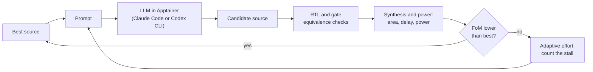

# ARES

**Adaptive Reasoning-Effort Steering for PPA- and Cost-Aware RTL Optimization with LLM Agents**

[](https://arxiv.org/abs/2607.27879)
[](https://github.com/KULeuven-MICAS/ARES/actions/workflows/tests.yml)
[](LICENSE)


This repository holds the code of the paper
[ARES: Adaptive Reasoning-Effort Steering for PPA- and Cost-Aware RTL Optimization with LLM Agents](https://arxiv.org/abs/2607.27879).

ARES improves the register-transfer level (RTL) source of a hardware design with
a large language model (LLM). The model proposes a new version of the source.
ARES verifies, synthesizes, and measures every candidate, and keeps it only when
the figure of merit (FoM) improves. The FoM is the product of area, power, and
delay, each relative to the original source. Lower is better.

The reasoning effort of the model sets the cost of a call. ARES uses medium
effort by default and changes to high effort only when the progress at medium
effort stalls. A fixed effort for every call is also available.



## Features

- **Two model providers.** Claude Code and the Codex CLI, each with all tools
  disabled. Every model call runs in an Apptainer container.
- **Adaptive reasoning effort.** A stall counter starts a short burst of high
  effort. The defaults are the constants of the paper for each provider.
- **Optimization notes.** A Markdown file with optimization directions. ARES
  sends it in the first message of each session and keeps it in the session
  history.
- **Strict acceptance.** Random simulation compares each candidate with the
  original source at RTL and at gate level. JasperGold sequential equivalence
  checking (SEC) is optional.
- **Measured PPA.** Synopsys Design Compiler gives area and delay. PrimeTime
  gives averaged power from gate-level switching activity.
- **Cost control.** A cost limit in US dollars, and a record of each call with
  its tokens and cost.
- **Full records.** Every prompt, reply, candidate, and measurement goes into
  a JSON Lines file, with a Markdown report per run.

## Requirements

ARES runs on Linux. The table gives the versions of our experiment runs.

| Program | Version | Use | Needed |
| --- | --- | --- | --- |
| Python | 3.11.13 | The flow (standard library only) | Always |
| Synopsys Design Compiler (`dc_shell`) | U-2022.12-SP2 | Synthesis, area, delay | Always |
| Synopsys Library Compiler (`lc_shell`) | U-2022.12-SP2 | Compiles the `.lib` file once | With a `.lib` library |
| Synopsys PrimeTime (`pt_shell`) | U-2022.12-SP2 | Power analysis | Always |
| Siemens QuestaSim (`vlib`, `vlog`, `vsim`) | 2022.4 | RTL and gate-level simulation | Always |
| Cadence JasperGold (`jaspergold`) | 2025.09 | Formal equivalence | Only with `--sec-plus-tb` |
| Apptainer | 1.5 | Container for the model calls | For model calls |
| Claude Code CLI | 2.1.181 (pinned) | Claude models | For Claude runs |
| Codex CLI | 0.149.0 | OpenAI models | For Codex runs |

The commercial tools need their licenses. The repository includes the
technology: the open NanGate 45 nm cell library in [tech/nangate45](tech/nangate45).

## Installation

1. Get the source.

   ```bash
   git clone https://github.com/KULeuven-MICAS/ARES.git
   cd ARES
   ```

2. Copy the settings file to a place outside the repository, and edit it. The
   file tells which program to put on the `PATH` and which path to set. Load it
   in every shell that runs ARES.

   ```bash
   cp config/settings.example.sh ~/ares-settings.sh
   source ~/ares-settings.sh
   ```

3. Run the offline tests. They need no tool, license, or model access.

   ```bash
   python3.11 -m unittest discover -s tests
   ```

4. Measure the example design. This step tests the hardware tools and makes no
   model call.

   ```bash
   python3.11 optimize.py --config examples/designs.json --iters 0 \
       --out results/sad4-baseline
   ```

5. Make the container image for the model calls (about 70 MB).

   ```bash
   apptainer pull "$RTL_FLOW_SIF" \
       docker://rockylinux@sha256:9794037624aaa6212aeada1d28861ef5e0a935adaf93e4ef79837119f2a2d04c
   ```

   The digest is the Rocky Linux 8 image of our runs. If the registry does not
   have this digest, use `docker://rockylinux:8`. On a system without FUSE,
   unpack the image into a folder and set `RTL_FLOW_SIF` to that folder:
   `apptainer build --sandbox ~/ares/rockylinux8 "$RTL_FLOW_SIF"`.

6. Install the pinned Claude Code CLI, log in, and check the container. The
   installation script downloads the CLI and verifies its SHA-256 checksum.
   For the login options and for Codex, see [docs/providers.md](docs/providers.md).

   ```bash
   CLAUDE_BIN="$HOME/ares/claude-2.1.181/claude" bash fetch_cli.sh
   bash box_claude.sh --check
   ```

## Quick start

The example design [examples/sad4](examples/sad4) is a small sum-of-absolute-
differences unit. Each command below makes model calls and costs money.

```bash
# The adaptive policy, stopped at a model cost of USD 5.
bash box_claude.sh --config examples/designs.json --adaptive-effort \
    --max-cost 5 --out results/sad4-adaptive

# Optimization notes and formal equivalence checks.
bash box_claude.sh --config examples/designs.json --adaptive-effort \
    --md examples/notes.md --sec-plus-tb --iters 5 --out results/sad4-notes

# Five iterations at a fixed medium effort.
bash box_claude.sh --config examples/designs.json --effort medium --iters 5 \
    --out results/sad4-medium
```

Each run writes `results/<name>/runs/<design>/<time>/report.md`. The report
shows the best source and one table row per attempt.

## Use your own design

Describe the design in a JSON registry; [examples/designs.json](examples/designs.json)
is a template. Each entry names the top module, the source files, and each port
with its role and width. The first source file is the file that ARES optimizes.

```json
{"designs": [{
  "key": "sad4", "top": "sad4", "src_files": ["sad4/sad4.v"], "lang": "v",
  "clocks": ["clk"], "resets": [["rst_n", "low"]],
  "inputs": [["valid_in", 1], ["a", 32], ["b", 32]],
  "outputs": [["sad", 10], ["valid_out", 1]],
  "extract_top": false, "clock_gating": true, "pt_hold": []
}]}
```

[docs/configuration.md](docs/configuration.md) describes every field and
setting. Use `--list-designs` and `--plan` to check a registry without tools or
model calls.

## Reasoning effort

| Mode | Options |
| --- | --- |
| Adaptive effort | `--adaptive-effort` (add `--start-high` to start with a burst) |
| Fixed effort | `--effort low`, `--effort medium`, or `--effort high` (default) |

The adaptive policy uses medium effort. A candidate that is valid but not better
adds 1 to a stall counter, and a failed candidate adds the fail weight. When the
counter reaches the patience value, the next iterations use high effort, with a
prompt that asks for a structural change. An improvement ends the burst and
reduces the counter. [docs/method.md](docs/method.md) gives the full rules.

The defaults are the constants of the paper for each provider:

| Constant | Option | Claude (Opus 4.6) | Codex (GPT-5.5) |
| --- | --- | --- | --- |
| Patience *p* | `--adaptive-patience` | 3 | 4 |
| Fail weight *w* | `--adaptive-fail-weight` | 2.8 | 4 |
| Reset scale *κ* | `--adaptive-reset-rho` | 0.05 | 0.1 |
| Burst length | `--adaptive-high-iters` | 1 | 1 |

## Experiment settings

These options give the arms of our experiments. The equal-cost comparisons used
`--max-cost` with one budget per design and model: the cost of the first 15
calls of a calibration run.

| Arm | Options |
| --- | --- |
| Calibration (cost unit and budget) | `--effort high --iters 20 --md NOTES` |
| Fixed low, medium, or high effort | `--effort {low,medium,high} --md NOTES` |
| Adaptive effort | `--adaptive-effort --md NOTES` |
| No notes | `--effort medium` |
| Continuation from a given source | `--v0-rtl SOURCE --adaptive-effort --start-high --md NOTES` |

All runs used `--lean`. The effort and memory experiments used 10,000
verification vectors (the default), and the bit-exact MX MAC runs used
`--vectors 100000`. The runs on the two designs with a clock and a reset in the
effort and memory experiments also used `--sec-plus-tb`. Claude runs used CLI
2.1.181, and Codex runs used CLI 0.149.0 with
[config/prices.gpt-5.5.json](config/prices.gpt-5.5.json). The MX MAC runs with
an accuracy tolerance used a testbench specific to that design; this repository
does not include it.

The prompts are identical to the prompts of our experiment code. A test checks
this ([tests/test_prompts.py](tests/test_prompts.py)).

## Outputs

```text
results/<name>/
├── run_summary.json              # status and best score of each design
├── designs/<design>/             # work copy: sources, testbenches, golden trace
└── runs/<design>/<time>/
    ├── report.md                 # summary and one row per attempt
    ├── test_data.jsonl           # one JSON record per baseline, attempt, and stop
    ├── session.log               # full log of the run
    ├── v0/                       # baseline sources, measurements, timing proof
    ├── v1/, v2/, ...             # each accepted source with its measurements
    └── iters/i01/, i02/, ...     # candidate source and tool logs of each attempt
```

## Repository layout

| Path | Content |
| --- | --- |
| `optimize.py` | The optimization loop and its command line |
| `harness.py` | Testbench generation and flow control |
| `synthesis.py` | Runs the hardware flow in a work directory |
| `designs.py` | Reads and checks the design registry |
| `flow/` | Stage runner and the Design Compiler and PrimeTime scripts |
| `box_claude.sh`, `box_codex.sh`, `box_runtime.py` | Container launchers |
| `codex_backend/` | Codex CLI configuration and request checks |
| `repair_session.py` | Repairs a Claude session after a context compaction |
| `fetch_cli.sh` | Installs the pinned Claude Code CLI |
| `tech/nangate45/` | NanGate 45 nm cell library |
| `examples/` | Example design, registry, and notes file |
| `config/` | Settings template and the GPT-5.5 price file |
| `docs/` | Configuration, method, and provider documentation |
| `tests/` | Offline tests |

## Tests

```bash
python3.11 -m unittest discover -s tests
```

The tests replace the hardware tools and the model with fakes. They check the
loop, the acceptance rules, the adaptive policy, the cost limit, the launchers,
the flow scripts, and the prompts. They do not run a licensed tool or a model.

## Citation

If you use ARES, please cite the paper:

```bibtex
@misc{cuyckens2026ares,
  title         = {{ARES}: Adaptive Reasoning-Effort Steering for {PPA}- and Cost-Aware {RTL} Optimization with {LLM} Agents},
  author        = {Cuyckens, Stef and Jivanescu, Mihaela and Yin, Jun and Fang, Chao and Verhelst, Marian},
  year          = {2026},
  eprint        = {2607.27879},
  archivePrefix = {arXiv},
  primaryClass  = {cs.AR},
  url           = {https://arxiv.org/abs/2607.27879}
}
```

## License

Copyright 2026 KU Leuven. ARES is released under the
[Apache License 2.0](LICENSE). The NanGate 45 nm library in `tech/nangate45`
has its own Apache 2.0 license; see [NOTICE](NOTICE).
